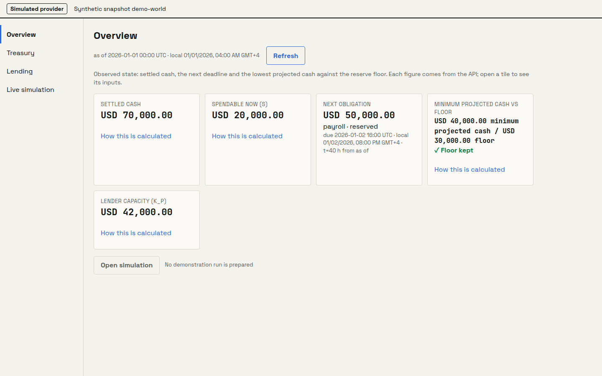

# LedgerWorld

An agentic treasury that rehearses a crisis before it spends a dollar. It loads a company's cash,
obligations, borrowers and counterparties into a coupled agent world, lets a shock play out round
by round, compares protective plans on the same shocks, and executes only the plan that still
meets every obligation through the Airwallex sandbox, then reconciles the result against its own
ledger.

Built on [MiroFish](https://github.com/666ghj/MiroFish) (AGPL-3.0); see `UPSTREAM.md` and
`ATTRIBUTION.md` for exactly what changed.

**Live:** <https://peterson-prefix-assumptions-hits.trycloudflare.com> (simulated provider until the sandbox keys land).

## What it is

- **A ledger first.** Money is integer minor units with an ISO currency; journals are
  double-entry; zero, unknown and stale are three different states, and a stale balance blocks an
  execution instead of guessing.
- **A coupled agent world.** Eight synthetic actors (a treasury, a lender pool, two more
  borrowers, a payroll bureau, an exchange venue, a market-maker and a public feed) act through
  typed intents. A deterministic coordinator clears every intent against the ledger, so a model
  proposes and the ledger decides.
- **Plans compared on the same shock.** No action, a fixed reserve and an integrated plan (draw an
  advance, defer, convert just in time) each run in a fresh branch on the same seed. They are
  ranked by unmet obligations, then branches that breach the reserve floor, then the largest
  short, then funding cost. Nothing is averaged.
- **Execution only outside the simulation.** The chosen plan is decided again on the observed
  snapshot and bound into an approval. Only then does it cross the execution gateway to Airwallex.
  Each transfer and conversion leg is reconciled against the ledger by a `GET`. The simulation
  process never holds an Airwallex credential.



## Run the demo

No keys, no network, no database server. The provider is the built-in fake and the models are
scripted:

```bash
uv sync
bash scripts/demo.sh --mode fake --out var/demo/fake.json
uv run python checks/demo_receipt.py var/demo/fake.json
```

It prints the seven beats (state → world → shock → fork → break → execute → reconcile) and writes
a receipt that `checks/demo_receipt.py` validates. A run takes about half a minute.

To see the screens in fake mode:

```bash
npm --prefix frontend ci
npm --prefix frontend run build     # the build calls the API at http://localhost:5001 by default
AIRWALLEX_MODE=fake LEDGERWORLD_ROLE=api LEDGERWORLD_DEMO_TOKEN="$(openssl rand -hex 16)" \
  uv run bash deploy/entrypoint.sh
# open http://localhost:5001/overview  (also /treasury, /lending, /simulation?run_id=<run>,
#   /decisions and /execution)
```

`deploy/entrypoint.sh` serves the API and the built frontend on one origin, on port 5001. It skips
the upstream key check on purpose, so the fake-provider demo needs no model or graph-memory key.
Every page carries a banner naming the provider mode: "Simulated provider" here.

## Setup

Requirements: Python 3.12 and [uv](https://docs.astral.sh/uv/); Node 20+ for the frontend.

```bash
uv sync                      # backend, packages/oasis-finance and dev tools
cp .env.example .env         # fill in values; never commit .env
bash checks/merge.sh         # lint, secrets, attribution, offline tests, frontend build
```

**Sandbox keys.** These are names only. `.env.example` lists every variable, and values belong in
`.env` or the host's secret store:

| Purpose | Variables |
|---|---|
| Airwallex sandbox | `AIRWALLEX_MODE=sandbox`, `AIRWALLEX_CLIENT_ID`, `AIRWALLEX_API_KEY`, `AIRWALLEX_API_VERSION` (≥ 2024-09-27), `AIRWALLEX_CONNECTED` (auto · on · off), `AIRWALLEX_WEBHOOK_SECRET`, optional `AIRWALLEX_GLOBAL_ACCOUNT_ID` |
| Model (OpenAI-compatible) | `LLM_API_KEY`, `LLM_BASE_URL`, `LLM_MODEL_NAME`, optional `LLM_BOOST_*` |
| Graph memory | `ZEP_API_KEY` |
| Storage and queue | `LEDGER_DATABASE_URL` (SQLite in memory when unset), `REDIS_URL` |
| App | `LEDGERWORLD_ROLE` (api · worker · sim), `LEDGERWORLD_DEMO_TOKEN` (needed by every write route), `LEDGERWORLD_URL`, `LEDGERWORLD_LLM_DAILY_USD` |

The production Airwallex host is refused by code. A sandbox demo run:
`bash scripts/demo.sh --mode sandbox --out var/demo/live.json --beneficiary <id>`, plus
`--connected-account <id>` when connected accounts are enabled (Mode A).

**One machine.** `docker compose -f deploy/compose.yml --env-file .env up -d --build` starts the
app, the simulation worker, PostgreSQL 16 and Redis 7. With no variables set, it runs in fake mode.

**Tests.** The merge gate runs offline. Tests marked `live` or `pg` are skipped by default.
`uv run pytest -m pg` runs the PostgreSQL tests against `LEDGER_DATABASE_URL`, and
`npm --prefix frontend run test:unit` runs the frontend unit tests.

## Architecture

```
snapshot (C5) + ledger ──► agent world ──► coupled simulation ──► policies, compared per branch
                                                                         │ decided again on the
                                                                         ▼ observed snapshot
            reconciliation ◄── receipts (C4) ◄── Airwallex sandbox ◄── gateway ◄── bound approval (C3)
```

The full picture covers the system shape, the credential boundary, the round order and the module
map: [docs/architecture.md](docs/architecture.md). Every contract (C1–C6) and the ledger tables
are in [docs/schema.md](docs/schema.md).

## Honesty notes

- **Simulated:** every actor, company and balance is synthetic (`fixtures/`,
  `scenarios/world.json`). The agent world, its shocks and its branches are simulation. The
  collateral facility exists only in simulation and tests, never as a provider leg.
- **Fake provider:** in fake mode every Airwallex call goes to the in-process `FakeTransport`,
  which reproduces the sandbox's rules (duplicate `request_id` rejection, transfer status walk).
  Its receipts are not provider receipts.
- **Sandbox:** in sandbox mode, the legs are real Airwallex **sandbox** objects. No production
  money moves. When connected accounts are not enabled (Mode B), the advance is a sandbox deposit
  simulation labelled "advance inflow (sandbox simulation)", and it is never described as a
  lender disbursement through Airwallex. The repayment is ledger-only and labelled simulated. The
  connector has no deposit lookup, so a Mode B deposit whose outcome is unknown stays unknown for
  the operator rather than being resolved by a `GET`. The receipt says which mode ran. No sandbox
  receipt is committed in this repository yet.
- **Scripted vs live model:** in fake mode, the actors' choices come from a `ScriptedModel` plan.
  That proves the wiring, not an independent model's judgement. The demo receipt records
  `model: scripted` or `live`. The deployed worker runs scripted families only, and
  `/api/v1/health` reports `model: scripted`.
- **Replay:** a branch re-run from transcripts is labelled replay. The demo simulates its branches
  afresh on every run.
- **Screens and runs:** Decisions (`/decisions`) and Execution (`/execution`) read a prepared
  run. Without the job queue (`REDIS_URL`), the local server above has no run to show, so those
  screens and Simulation have nothing to display. The demo's Break beat shows the losing
  policies' failure conditions. Reverse stress (`backend/app/decisions/reverse_stress.py`) is
  tested but is not part of the demo.

## Attribution

LedgerWorld is a modified version of MiroFish at commit
`7657031ac01184afe2cb220f5ee3545573b5e843`. The import is byte-identical: the parentless commit
`import: upstream engine at 7657031, unmodified` has the upstream tree hash. Everything after it is
this project's.

- `ATTRIBUTION.md` lists every file this project added and every upstream file it changed, with
  the reason. `checks/attribution.py` fails the merge gate when a changed upstream file is not
  listed.
- To see every change against upstream, run
  `git diff --name-status dcc88f9b1da4145a06769a7f979d50d77e1dba25`. That is the upstream tree
  hash, which needs no tag. `UPSTREAM.md` shows how to tag the import commit as
  `upstream-7657031` in your clone.
- `NOTICE` names the Apache-2.0 dependencies (`camel-oasis`, `camel-ai`). They are extended in
  `packages/oasis-finance` and never edited.

## Licence

AGPL-3.0, the licence of the upstream engine and of the combined work. See `LICENSE` and `NOTICE`.
Building the frontend with `VITE_SOURCE_URL=<repository URL>` adds a source link to every page
footer (AGPL §13). The image in `deploy/` does not set it yet, so a public deployment must pass
it at build time.
