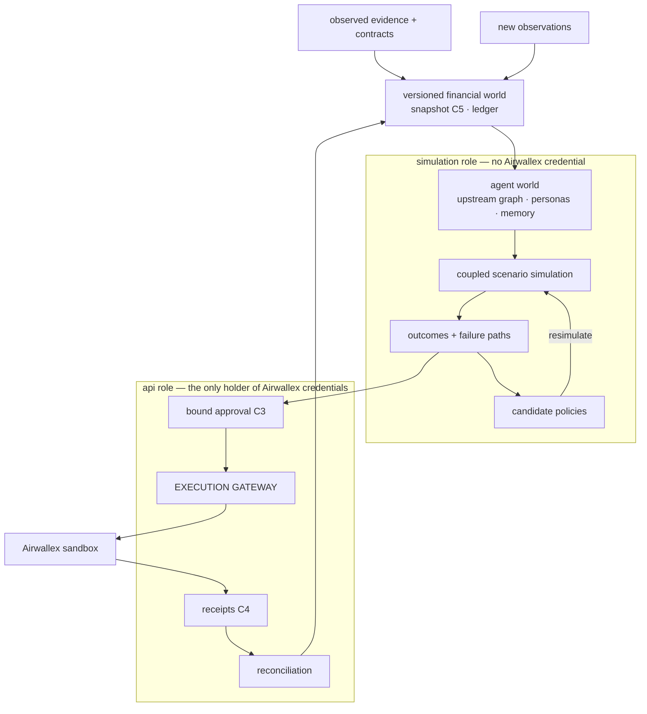

# Architecture

LedgerWorld is the upstream MiroFish engine (a Flask backend and a Vue 3 frontend) with a finance
layer around it. The layer has a ledger, an agent world coupled to that ledger, a decisions layer
that compares plans, and an execution gateway that is the only code path to Airwallex. All of it
is new code in new modules. The upstream app is touched only to register the `/api/v1` blueprint
and the new frontend routes (`ATTRIBUTION.md`).

## System shape

The hard rule of the shape is that **external execution never happens inside a hypothetical
branch**. A policy that wins in simulation is a decision, not an approval. The selected policy is
decided again on the current observed snapshot (`decisions.candidates.plan_for_now`), the plan is
bound into a C3 approval, and only that approval crosses the gateway.

## The credential boundary

| Process | Role | Airwallex variables | Imports `app.connectors.airwallex.live` |
|---|---|---|---|
| API + frontend | `api` | yes | yes, via the gateway |
| Simulation worker | `sim` / `worker` | removed by `deploy/entrypoint.sh` before start | never |
| Demo simulation child | `sim` | absent from its environment; dotenv disabled | never; it says so, and the parent checks |

`deploy/compose.yml` passes no `AIRWALLEX_*` name to the worker. The entrypoint also removes any
that arrive and sets `PYTHON_DOTENV_DISABLED`, so `.env` cannot put them back.
`tests/execution/test_import_fence.py` proves the import fence.

## One round (transactional)

1. Advance the clock.
2. Deliver the scheduled scenario events.
3. Publish public posts.
4. Build each actor's scoped, hashed observation.
5. Agents propose C1 intents through finance tools (`packages/oasis-finance`).
6. Validate each intent: schema, mandate, authority.
7. Clear the intents in a fixed order (priority class → simulated time → actor id) against the
   ledger.
8. Run the mandatory settlements.
9. Return C2 results to the actors.
10. Commit the round and append the transcript.

An unhandled failure in any step restores every round-start state: ledger, OASIS SQLite, memory,
clocks, RNG, event cursor and queues. A rejected intent becomes `no_action` and is not a failure.

## Modules

| Path | Holds |
|---|---|
| `backend/app/finance/` | money and contract schemas, the double-entry ledger store (SQLAlchemy Core: SQLite or PostgreSQL), spendability S and projected cash P, lending (K_p, revenue advances), collateral (simulation only) |
| `backend/app/simulation/` | world, clock, coordinator, observations, branches, graph memory per branch, transcripts, the six scenario families, read-only interview |
| `packages/oasis-finance/` | camel-oasis extensions: typed finance tools that queue C1 intents, scoped observations, a one-repair guardrail |
| `backend/app/decisions/` | the three policies, feasibility, the lexicographic objective, nonanticipativity, reverse stress |
| `backend/app/execution/` | approval binding (C3), the gateway, the outbox (one row per leg, written before any call), leg states, reconciliation |
| `backend/app/connectors/airwallex/` | client, `FakeTransport`, the live sandbox transport (production host refused), webhook signature checks |
| `backend/app/api/v1/` | the C6 routes; reads are public, writes need `LEDGERWORLD_DEMO_TOKEN` |
| `backend/app/jobs/` | the run queue (Redis) and its records; `python -m app.jobs` is the worker |
| `backend/app/reports/` | grounded reports: every figure names its source |
| `backend/app/demo/` | the seven-beat demo behind `scripts/demo.sh` |
| `backend/app/testing/` | `ScriptedModel`, `FakeGraphMemory` and their plans |
| `frontend/src/views/` | Overview, Treasury, Lending, Simulation, Decisions, Execution (new); the upstream views are unchanged |

## The execution path

1. The gateway checks the approval against its bound terms: legs, amounts, plan hash, snapshot
   and expiry. Any term outside the bound refuses the whole approval.
2. It writes one outbox row per leg. The leg id is the provider `request_id`, so a retry never
   moves money twice.
3. It claims and sends each leg.
4. An unknown outcome or a duplicate-id rejection resolves by `GET …?request_id=` and never by a
   resubmission under a new id.
5. A leg settles, and its journal posts, in one transaction, and only when a `GET` shows terminal
   success in the leg's own amount and currency. A webhook is a verified hint that triggers that
   `GET`.

The exception is the Mode B deposit. It carries no `request_id` (its reference carries the leg id)
and the connector has no deposit lookup, so an unknown deposit stays unknown for the operator.
The orphan sweep skips deposits for the same reason.

| Leg | Mode A · connected accounts | Mode B · fallback |
|---|---|---|
| Advance | connected-account transfer | sandbox deposit simulation, labelled as such |
| Repayment | charge on the borrower | ledger-only, labelled simulated |
| FX | quote + conversion | quote + conversion |
| Payout | transfer on behalf of the borrower | transfer from the operator account |
