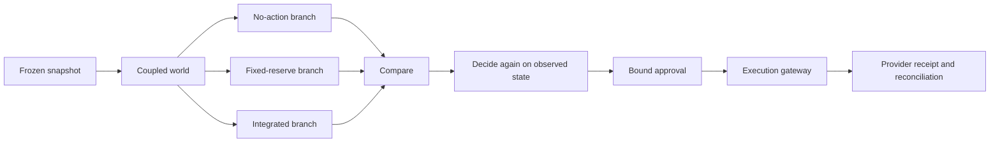

# LedgerWorld

> Submission copy and readiness checklist. The video has not been recorded or published.
> The checker counts pack items, not verified deployment health or sandbox checkpoints.
> Do not submit until the missing links and recording prerequisites below are resolved.

## One-liner

An agentic treasury that rehearses a cash crisis in a coupled world before executing a bounded plan.

## Description

LedgerWorld turns a frozen synthetic company's cash, obligations and shared exposures into an
agent world. A public confidence shock changes borrowers' requests; the lender's response changes
cash and available capacity, which changes what the treasury can do next. Actors see scoped
observations and propose typed intents. A deterministic coordinator clears those intents against
an integer-minor-unit, double-entry ledger.

The operator compares no-action, fixed-reserve and integrated policies on the same shocks in
separate branches. Obligations and the reserve floor constrain the result. A selected policy is
decided again on the observed snapshot before an expiring, bounded approval can reach the execution
gateway. Simulation is not an approval. Missing or stale balances cannot authorize spending.



*All three comparison branches terminate at the same decision boundary; none has a provider edge.*

## Airwallex usage

The connector supports sandbox balances, FX quotes and conversions, and payroll payouts. It rejects
Airwallex's production host. Provider legs carry deterministic request IDs; transfers and conversions
with an uncertain outcome are queried before any retry, then reconciled into the ledger.

- **Mode A:** when connected accounts are enabled, the advance uses a connected-account transfer
  and repayment uses a charge on the connected account.
- **Mode B:** otherwise the advance is labelled **advance inflow (sandbox simulation)** and uses
  a sandbox deposit simulation. It is not a lender disbursement through Airwallex. Repayment is
  ledger-only, labelled **simulated**. An unknown deposit remains an operator incident because
  the connector has no deposit lookup. Wallet funding is setup, not a plan leg.
- **Fake provider:** local tests use FakeTransport. Its receipts are not Airwallex sandbox receipts.
  A sandbox receipt does not prove that any actor used a live model. No production money moves.

These are supported paths, not claims that a particular sandbox run succeeded. No sandbox receipt
is committed here. Record the actual provider mode, connected-account mode, request IDs, provider
IDs and reconciliation result from the recording's own run.

## Testing instructions

**No login is required for reading.** Open the Demo link below and start at `/overview`; follow
Open simulation → Compare policies → View execution → Open receipt. Public GET responses include
`/api/v1/health` and `/api/v1/overview`. The health response's provider and model labels must stay
visible in the recording. The currently documented deployment is fake/scripted; this pack does not
certify its availability or the presence of a prepared demonstration run.

An empty prepared run is unavailable evidence, not a successful demonstration. Write actions,
including starting a branch, approving, executing and the read-only actor interview POST, require
the operator's demo token. Do not publish or film that token. A judge can read without it.

For an offline reproduction, follow [Setup and Run the demo](../README.md):

```bash
uv sync
bash scripts/demo.sh --mode fake --out var/demo/fake.json
uv run python checks/demo_receipt.py var/demo/fake.json
uv run pytest -q tests/simulation/test_coupled.py::test_public_shock_traceable_response
uv run python checks/submission.py
```

The last command deliberately exits nonzero until all pack items are present; `--count` prints
only `n/8`. It does not contact links, a model or a provider. The existing g5 KPI consumes that
count with `uv run python checks/kpi.py g5 --print`.

For the recorded demonstration, use the already-provisioned sandbox configuration described in
[README](../README.md#setup). Validate its receipt with
`uv run python checks/demo_receipt.py var/demo/live.json --require-live` and check the prepared
public path with `bash scripts/judge-path.sh "$LEDGERWORLD_URL"`. The command-line demo uses its
own store: its receipt must not be presented as the public API's execution without an explicit
association. A green offline test proves neither sandbox execution nor a working public demo.

## Links

- Repository: https://github.com/Yarrroo/ledgerworld
- Demo: https://peterson-prefix-assumptions-hits.trycloudflare.com
- Video: pending recording and publication; the [shot list](video-script.md) is not a video URL.
- Setup: [README](../README.md#setup)
- Architecture: [System and boundaries](architecture.md)
- Contracts: [Schemas](schema.md)
- Licence and changes: [AGPL-3.0](../LICENSE), [Attribution](../ATTRIBUTION.md)

Before pasting the form: replace the Video line with the published HTTPS walkthrough URL, confirm
that the Demo line still matches the deployed address, open both without a login, and run the
checker again. Do not describe `8/8` pack completeness as verified event acceptance.
